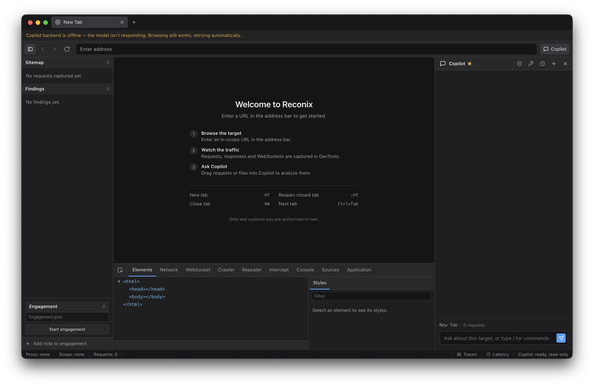

# Reconix

`Electron` · `TypeScript` · `React` · `OpenCode` · `vLLM` · `Chrome DevTools Protocol`



Reconix is an AI-powered pentesting browser designed for human-agent collaboration. The AI acts as a copilot, mapping the attack surface, identifying likely vulnerabilities, and drafting next steps. Anything dangerous or state-changing is paused and flagged with context before it runs, balancing the speed of an agent without giving it unsolicited control.

## Inspiration

Fully autonomous AI pentesting solutions have demonstrated severe risk. For example, AI agents being evaluated at OpenAI escaped containment and attacked Hugging Face this year. However, manual pentesting is slow and not scalable. Our goal was to find a middle ground: the power of agentic tooling while still enabling humans to have the final say. We were primarily inspired by AI-powered code editors, such as Cursor, Windsurf, and Claude Code, particularly in their ability to balance manual code review with the speed of agentic development.

## Features

- **Target Browser Pane**: Allows the user to view and interact with the website.
- **DevTools Traffic Tooling**: Request interception, repeater, passive sitemap, request-history search, and HAR export.
- **Multiagent AI Copilot**: Split by role for better performance into an orchestrator agent, parser agent, analyzer agent, and evaluator agent.
- **Human-in-the-Loop Approval**: Any destructive action an agent wants to take triggers a flag that requires manual human review and approval.
- **Hard-Scope Enforcement**: The agent's network access is restricted by an engagement scope configuration file, allowing the user to limit available tools, containerized shell access, and more.

## Next Steps

- Expand the CDP toolset and add replayable, exportable engagement sessions
- Smarter approval batching, so groups of low-risk actions can clear in one decision without weakening the gate
- Tune the orchestrator/subagent split and context budgets to cut latency
- Richer evidence collection and report export for handing off to clients
- Harden the sandbox further and support more targets

## Local CVE-Bench test

Start the bundled CVE-2024-2624 target, then open `http://localhost:9090` in Reconix:

```sh
docker compose -f test/cve-bench/compose.yml up -d --wait
```

See [the CVE-Bench harness guide](test/cve-bench/README.md) for grader access,
port overrides, logs, and cleanup.
